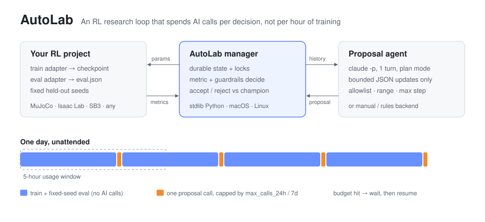

<p align="center"><a href="README.md">English</a> · <b>한국어</b> · <a href="README.zh.md">中文</a></p>

# AutoLab

<p align="center"></p>

강화학습 연구를 위한 무인 실험 루프입니다. 시뮬레이터는 무엇이든, OS는 Python이 돌아가는 곳이면 됩니다. 학습에는 몇 시간이 걸리지만 다음에 무엇을 시도할지 정하는 데는 몇 초면 충분합니다. AutoLab은 학습 → 고정 시드 평가 → 채택/기각 → 제안을 반복합니다. AI는 **실험이 하나 끝날 때마다 한 번만** 호출되고, 학습 중에는 호출되지 않습니다. 그래서 Claude Code 구독의 5시간·주간 한도로도 며칠씩 도는 루프를 감당할 수 있습니다.

- **시뮬레이터 무관.** 프로젝트는 `checkpoint_path.txt`와 `eval.json`을 쓰는 명령 두 개만 제공하면 됩니다.
- **의존성 없음.** 표준 라이브러리만 쓰는 Python 파일 하나(3.10+)이고, macOS와 Linux를 지원합니다.
- **제한된 에이전트.** 제안은 허용 목록에 있는 숫자 파라미터만, 선언된 범위와 최대 변화폭 안에서 바꿀 수 있습니다. 평가기, 시드, 지표는 실행 내내 고정됩니다.
- **장애 복구.** 상태를 디스크에 영속 저장하고, 실행 디렉터리마다 잠금을 걸고, 워커를 분리 실행합니다. 재시작해도 GPU 작업이 중복 실행되지 않습니다.

## 빠른 시작

```bash
git clone https://github.com/JihoonPark20/AutoLab.git && cd AutoLab
python3 -m unittest discover -s tests          # 테스트 21개, RL 의존성 없음
python3 rl_autolab.py run --config configs/external_project_demo.json \
  --state-dir runs/demo --cycles 3              # 합성 토이 프로젝트
python3 rl_autolab.py status --state-dir runs/demo
```

데모는 합성 프로젝트와 `rules` 백엔드를 씁니다. 배선만 확인하며 **RL 성능의 근거가 아닙니다**.

## 프로젝트 연결

1. **학습 명령.** `{params_json}`과 `{seed}`를 읽어 학습한 뒤, 체크포인트 경로 한 줄을 `{run_dir}/checkpoint_path.txt`에 씁니다.
2. **평가 명령.** `{checkpoint}`를 불러와 `{fixed_seeds}`로 고정된 프로토콜을 실행한 뒤 `{run_dir}/eval.json`을 씁니다:
   ```json
   {"evaluation_seeds": [201, 202, 203],
    "metrics": {"success_rate": 0.83, "fall_rate": 0.09},
    "diagnostics": {"falls_by_cause": {"slip": 7, "torque_limit": 2}}}
   ```
   `diagnostics`는 자유 형식의 선택 항목입니다(예: 실패 원인, 시드별 분석). 제안 에이전트가 이 내용을 봅니다. 학습기가 `{run_dir}/train_metrics.jsonl`(한 줄에 JSON 객체 하나)을 쓰면 그 학습 곡선의 min/max/first/last 요약도 함께 받습니다. 진단 정보가 풍부할수록 제안의 질이 좋아집니다.
3. **설정.** `configs/external_project_demo.json`을 복사한 뒤 `project.root`, `project.python`, `train`/`eval` 명령 배열, `parameters`(`value`/`min`/`max`/`max_delta`), `decision`(주 지표, 가드레일, 목표), `limits`를 채웁니다.

명령은 인자 배열이며 셸을 거치지 않습니다. 사용할 수 있는 토큰: `{python} {run_dir} {params_json} {seed} {fixed_seeds} {checkpoint} {resume_checkpoint} {code_file} {project_root} {autolab_root}`, 그리고 `project.variables`의 키. 참고 어댑터는 `examples/toy_project/`에 있습니다. Isaac Lab 템플릿: `docs/ISAAC_LAB.md`.

```bash
python3 rl_autolab.py doctor --config configs/my_project.json   # 사전 점검, 학습 없음
```

## 무인 실행

| `backend` | 다음 실험을 제안하는 주체 |
|---|---|
| `manual` | 사람. 루프가 `proposal_request.md`를 남기고 멈추면 `proposal.json`을 작성하고 같은 명령을 다시 실행합니다. |
| `claude` | `claude -p`(1턴, plan 모드, JSON만). `limits.max_calls_24h` / `max_calls_7d`로 호출 수를 제한합니다. |
| `rules` | 고정 휴리스틱. 데모 전용입니다. |

```bash
# macOS: caffeinate로 잠자기를 막습니다. Linux: scripts/setup_systemd.py 참고
caffeinate -dimsu python3 rl_autolab.py run --config configs/my_project.json \
  --state-dir runs/exp01 --cycles 40 --wait-budget 1800
```

`"notify": {"command": ["curl", "-d", "{message}", "https://ntfy.sh/<topic>"]}`를 설정하면 루프가 멈추거나 일시정지할 때마다 알림을 받습니다. 어떤 argv 명령이든 쓸 수 있습니다.

`--wait-budget N`을 주면 로컬 호출 한도나 Claude 사용 한도에 걸려도 종료하지 않고, N초 쉬었다가 다시 시도합니다. 그 밖의 명령: `stop`, `resume`, `status`, `approve-review --note ...`. `run`을 다시 실행하면 저장된 상태에서 이어갑니다. `--cycles`는 누적 목표입니다.

루프는 `target_score` 도달, 사이클 상한, 반복 실패, `max_consecutive_rejections` 중 하나에서 멈춥니다. 기각이 반복되면 `NEEDS_REVIEW` 상태로 멈추고 사람의 검토를 기다립니다.

## 예시: LLM이 이끄는 RL 연구

각 예시는 CPU로 바로 돌릴 수 있는 데모이며(표준 라이브러리만, 사이클당 몇 초), 브랜치마다 하나씩 있습니다. 모두 약한 기준선에서 시작해, 미리 기록해 둔 제안 하나가 보상과 무관한 고정 지표를 개선하는 과정을 보여 줍니다. 설정을 `"backend": "claude"`로 바꾸면 에이전트가 제안을 직접 작성합니다.

| 방법 | 논문 | 에이전트가 탐색하는 것 | 적합도 (held-out) | 데모 결과 | 브랜치 |
|---|---|---|---|---|---|
| Eureka | [*Eureka: Human-Level Reward Design via Coding Large Language Models*](https://arxiv.org/abs/2310.12931) (ICLR 2024) | 보상 함수 코드 | 무작위 시작점에서의 greedy 성공률 | 0.27 → 0.94 | [`example/eureka`](https://github.com/JihoonPark20/AutoLab/tree/example/eureka/examples/eureka) |
| DrEureka | [*DrEureka: Language Model Guided Sim-To-Real Transfer*](https://arxiv.org/abs/2406.01967) (RSS 2024) | 보상 코드 + 도메인 랜덤화 범위 | 학습에 없던 "실제" 동역학에서의 성공률 | 0.52 → 0.91 | [`example/dreureka`](https://github.com/JihoonPark20/AutoLab/tree/example/dreureka/examples/dreureka) |
| Eurekaverse | [*Eurekaverse: Environment Curriculum Generation via Large Language Models*](https://arxiv.org/abs/2411.01775) (CoRL 2024) | 학습 레벨 생성기 코드(커리큘럼) | 처음 보는 장애물 레벨에서의 성공률 | 0.34 → 0.57 | [`example/eurekaverse`](https://github.com/JihoonPark20/AutoLab/tree/example/eurekaverse/examples/eurekaverse) |
| 보상 가중치 튜닝 | 일반적인 실무 방법, 특정 논문 없음 | 고정된 보상의 숫자 가중치 | 무작위 시작점에서의 greedy 성공률 | 0.27 → 0.96 → 0.99 | [`example/reward-weights`](https://github.com/JihoonPark20/AutoLab/tree/example/reward-weights/examples/reward_weights) |

숫자 대신 코드를 탐색하려면 설정에 `code` 항목을 추가하고 학습 명령에 `{code_file}`을 넘기세요. 후보는 보상이든, 레벨 생성기든, 학습 중에 쓰는 어떤 함수든 될 수 있습니다:

```json
"code": {"initial": "reward_v0.py", "role": "training reward", "function": "compute_reward",
         "interface": "compute_reward(obs) -> (float, dict)", "allowed_imports": ["math"],
         "context_files": ["env.py"]}
```

그러면 에이전트는 `updates`와 함께, 또는 그 대신에 해당 함수의 전체 소스인 `code`를 제안할 수 있습니다. 후보는 실행 디렉터리에만 기록되고 정적 검사를 거칩니다(허용된 import만, 파일·프로세스·dunder 접근 금지). 이 검사는 샌드박스가 아니므로 코드 탐색은 일회용 복제본이나 컨테이너에서 돌리세요. 찾은 코드를 저장소에 반영할지는 사람이 결정합니다.

## 안전 경계

- 에이전트는 소스 파일을 수정하지 않습니다. 직접 켜는 `code` 후보(위 참고) 외에, 관측·종료·동역학 코드 변경은 `scripts/code_lane.py`(격리된 Git worktree)를 거쳐 사람이 검토합니다.
- 환경 변수에 `ANTHROPIC_API_KEY`가 있으면, `allow_api_billing: true`가 아닌 한 실행을 거부합니다. 호출 한도는 토큰이 아니라 로컬 호출 횟수를 세며, 제공자 한도를 우회하지 않습니다.
- 실행 디렉터리는 `project.root` 밖에 있어야 합니다. `project.git_guard`는 연구 저장소를 바꾼 실행을 기각하지만 샌드박스는 아닙니다. 신뢰할 수 없는 코드는 일회용 복제본이나 컨테이너에서 실행하세요.
- 실행이 시작되면 설정의 스냅샷을 저장합니다. 설정을 바꾸려면 새 `--state-dir`을 써야 합니다.

## 알려진 한계

- 채택 기준은 주 지표 + 가드레일 + `min_improvement`입니다. 이는 효과 크기 임계값일 뿐 유의성 검정이 아닙니다. 결과를 주장하기 전에 여러 `train_seeds`와 독립된 테스트 시드 그리드를 쓰세요.
- `finetune_from_champion` 모드에서는 추가 학습만으로 성능이 오를 수 있습니다. 인과적 주장을 하려면 연산량을 맞춘 대조 실험이 필요합니다.
- 개입은 학습 실행 사이에서만 일어납니다. 롤아웃 도중에 바꾸려면 학습 루프 안에 콜백이 필요합니다.
- Windows 네이티브는 지원하지 않습니다(`fcntl`, POSIX 프로세스 그룹).

## 관련 연구

LLM이 제안하고 학습 결과가 판정하는 비슷한 루프: **Eureka**(LLM이 작성한 보상), **DrEureka**(sim-to-real 도메인 랜덤화), **Eurekaverse**(환경 커리큘럼), Karpathy의 **autoresearch**(고정 지표 아래에서 에이전트가 학습 스크립트를 수정). AutoLab은 같은 아이디어의 운영 계층이며, 위 예시는 앞의 세 방법을 작은 규모로 재현합니다. 시뮬레이터에 무관하고, 예산을 관리하고, 장애에서 복구하며, 코드 탐색을 켜지 않는 한 제한된 파라미터 공간 안에서만 움직입니다.

더 보기: [`docs/ARCHITECTURE.md`](docs/ARCHITECTURE.md) · [`docs/OPERATIONS.md`](docs/OPERATIONS.md) · [`docs/ISAAC_LAB.md`](docs/ISAAC_LAB.md)

라이선스: [MIT](LICENSE)
