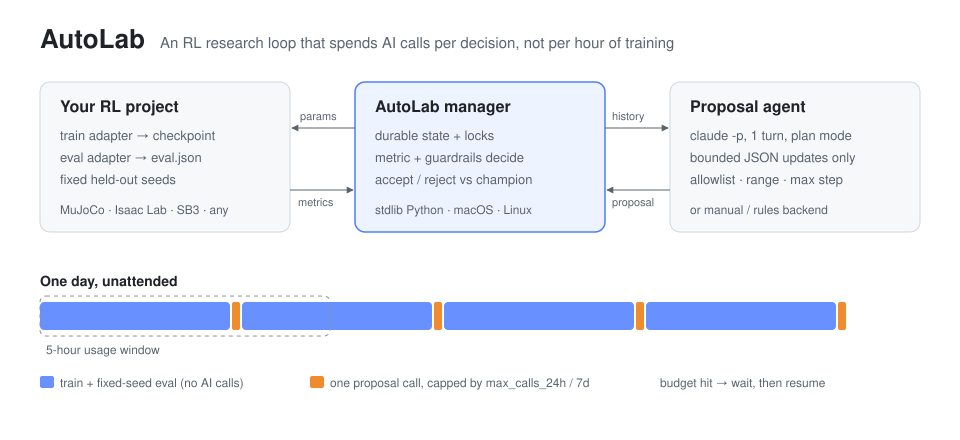
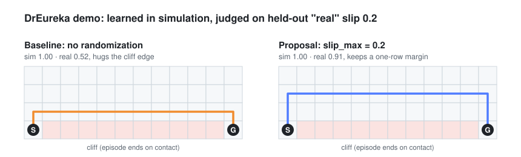

<p align="center"><b>English</b> · <a href="README.ko.md">한국어</a> · <a href="README.zh.md">中文</a></p>

# AutoLab

<p align="center"></p>

An unattended experiment loop for reinforcement-learning research. Any simulator and any OS that runs Python. Training takes hours, but deciding what to try next takes seconds. AutoLab runs train → fixed-seed eval → accept/reject → propose. The AI is called **once per finished experiment**, never while training runs. A Claude Code subscription's 5-hour and weekly limits can then cover a loop that runs for days.

- **Runs on your Claude Code subscription.** Proposals come from your own `claude` login: no API key, no per-token bill. The Eureka papers call a paid LLM API for every sample.
- **Simulator-agnostic.** Your project only has to provide two commands that write `checkpoint_path.txt` and `eval.json`.
- **Zero dependencies.** One stdlib Python file (3.10+), macOS and Linux.
- **Bounded agent.** Proposals may only change allowlisted parameters within declared ranges and step sizes, plus an opt-in code slot. The evaluator, seeds and metrics are frozen for the whole run.
- **Crash-safe.** Durable state, a lock per run directory and detached workers. Restarting never launches a duplicate GPU job.

## Quickstart

```bash
git clone https://github.com/JihoonPark20/AutoLab.git && cd AutoLab
python3 -m unittest discover -s tests          # 21 tests, no RL deps
python3 rl_autolab.py run --config configs/external_project_demo.json \
  --state-dir runs/demo --cycles 3              # synthetic toy project
python3 rl_autolab.py status --state-dir runs/demo
```

The demo uses a synthetic project and the `rules` backend. It checks the wiring only and is **not evidence of RL performance**.

## Connect your project

1. **Train command.** Reads `{params_json}` and `{seed}`, trains, then writes one line to `{run_dir}/checkpoint_path.txt` holding the checkpoint path.
2. **Eval command.** Loads `{checkpoint}`, runs your fixed protocol on `{fixed_seeds}`, then writes `{run_dir}/eval.json`:
   ```json
   {"evaluation_seeds": [201, 202, 203],
    "metrics": {"success_rate": 0.83, "fall_rate": 0.09},
    "diagnostics": {"falls_by_cause": {"slip": 7, "torque_limit": 2}}}
   ```
   `diagnostics` is optional free-form JSON, for example failure causes or per-seed breakdowns. The proposal agent sees it, together with a min/max/first/last summary of `{run_dir}/train_metrics.jsonl` (one JSON object per line) if your trainer writes one. Richer diagnostics lead to better proposals.
3. **Config.** Copy `configs/external_project_demo.json` and set `project.root`, `project.python`, the `train`/`eval` command arrays, `parameters` (`value`/`min`/`max`/`max_delta`), `decision` (primary metric, guardrails, target) and `limits`.

Commands are argument arrays, never run through a shell. Available tokens: `{python} {run_dir} {params_json} {seed} {fixed_seeds} {checkpoint} {resume_checkpoint} {code_file} {project_root} {autolab_root}`, plus any key in `project.variables`. A reference adapter is in `examples/toy_project/`.

```bash
python3 rl_autolab.py doctor --config configs/my_project.json   # preflight, no training
```

## Run unattended

| `backend` | Who proposes the next experiment |
|---|---|
| `manual` | You. The loop pauses with `proposal_request.md`; write `proposal.json` and rerun the same command. |
| `claude` | `claude -p` (one turn, plan mode, JSON only), capped by `limits.max_calls_24h` / `max_calls_7d`. |
| `rules` | A fixed heuristic, for demos only. |

```bash
# macOS: caffeinate keeps the machine awake. Linux: see scripts/setup_systemd.py
caffeinate -dimsu python3 rl_autolab.py run --config configs/my_project.json \
  --state-dir runs/exp01 --cycles 40 --wait-budget 1800
```

Set `"notify": {"command": ["curl", "-d", "{message}", "https://ntfy.sh/<topic>"]}` to get a message whenever the loop stops or pauses. Any argv command works.

`--wait-budget N` sleeps and retries when the local call cap or a Claude usage limit is hit, instead of exiting. Other commands: `stop`, `resume`, `status`, `approve-review --note ...`. Running `run` again continues from saved state; `--cycles` is the total target.

The loop stops on `target_score`, the cycle cap, repeated failures, or `max_consecutive_rejections`. On repeated rejections it pauses with `NEEDS_REVIEW` for a human.

## Examples: LLM-guided RL research

Small, self-contained re-implementations written for AutoLab. Each runs on CPU with the standard library in seconds per cycle. They are **toy versions of each method's loop, not ports of the official code**; the project pages show the real robot setups. Each starts from a weak baseline, and one recorded proposal improves a fixed, held-out metric. With `"backend": "claude"` the agent writes the proposals itself.

<p align="center"></p>

| Method | What the agent searches | Toy demo (held-out success) | Branch |
|---|---|---|---|
| [**Eureka**](https://eureka-research.github.io/) · ICLR 2024 · [paper](https://arxiv.org/abs/2310.12931) | Reward function code | 0.27 → 0.94 | [`example/eureka`](https://github.com/JihoonPark20/AutoLab/tree/example/eureka/examples/eureka) |
| [**DrEureka**](https://eureka-research.github.io/dr-eureka/) · RSS 2024 · [paper](https://arxiv.org/abs/2406.01967) | Reward code + domain-randomization range | 0.52 → 0.91 on unseen "real" dynamics | [`example/dreureka`](https://github.com/JihoonPark20/AutoLab/tree/example/dreureka/examples/dreureka) |
| [**Eurekaverse**](https://eureka-research.github.io/eurekaverse/) · CoRL 2024 · [paper](https://arxiv.org/abs/2411.01775) | Training-level generator code (curriculum) | 0.34 → 0.57 on unseen levels | [`example/eurekaverse`](https://github.com/JihoonPark20/AutoLab/tree/example/eurekaverse/examples/eurekaverse) |
| **Reward weight tuning** · common practice | Numeric weights of a fixed reward | 0.27 → 0.96 → 0.99 | [`example/reward-weights`](https://github.com/JihoonPark20/AutoLab/tree/example/reward-weights/examples/reward_weights) |

To search code instead of numbers, add a `code` section to your config and pass `{code_file}` to your train command. The candidate can be a reward, a level generator or any other training-time function:

```json
"code": {"initial": "reward_v0.py", "role": "training reward", "function": "compute_reward",
         "interface": "compute_reward(obs) -> (float, dict)", "allowed_imports": ["math"],
         "context_files": ["env.py"]}
```

The agent may then return `code`, the complete source of that function, alongside or instead of `updates`. Each candidate is written only into the run directory and checked statically (allowlisted imports, no file, process or dunder access). That check is not a sandbox, so run code search in a disposable clone or container. Promoting found code into your repo stays a human decision.

## Safety boundaries

- The agent never edits your source files. Beyond an opt-in `code` candidate (see above), observation, termination or dynamics changes go through `scripts/code_lane.py` (an isolated Git worktree) plus human review.
- `ANTHROPIC_API_KEY` in the environment is refused unless `allow_api_billing: true`. Call caps count local invocations, not tokens, and do not bypass provider limits.
- The run directory must sit outside `project.root`. `project.git_guard` rejects runs that change the research repo, but it is not a sandbox; use a disposable clone or container for untrusted code.
- The config is snapshotted when a run starts. Changing it requires a new `--state-dir`.

## Known limits

- Acceptance is primary metric + guardrails + `min_improvement`. That is an effect-size threshold, not a significance test. Use several `train_seeds` and an independent test seed grid before claiming results.
- In `finetune_from_champion` mode, a gain may come from extra training alone. Run a compute-matched control for causal claims.
- Interventions happen between runs. Changes in the middle of a rollout need a callback inside your training loop.
- Native Windows is unsupported (`fcntl`, POSIX process groups).

More: [`docs/ARCHITECTURE.md`](docs/ARCHITECTURE.md) · [`docs/OPERATIONS.md`](docs/OPERATIONS.md)

License: [MIT](LICENSE)
