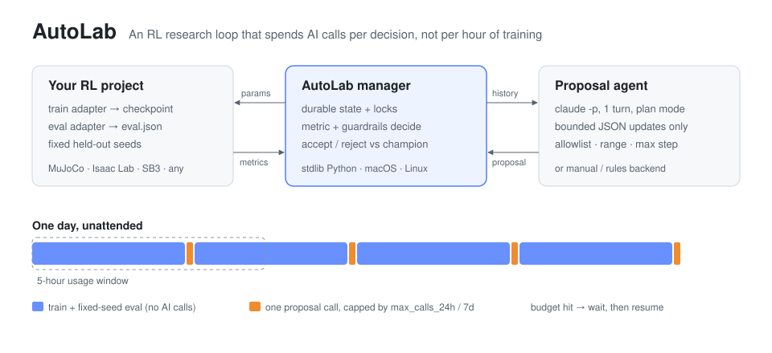

<p align="center"><a href="README.md">English</a> · <a href="README.ko.md">한국어</a> · <b>中文</b></p>

# AutoLab

<p align="center"></p>

面向强化学习研究的无人值守实验循环。任何仿真器都可以，任何能运行 Python 的操作系统都可以。训练需要数小时，而决定下一步尝试什么只需几秒。AutoLab 循环执行 训练 → 固定种子评估 → 接受/拒绝 → 提出新方案。AI **每完成一次实验只调用一次**，训练期间从不调用。因此，Claude Code 订阅的 5 小时与每周额度也足以支撑连续运行数天的循环。

- **与仿真器无关。** 项目只需提供两条命令，分别写出 `checkpoint_path.txt` 和 `eval.json`。
- **零依赖。** 只用标准库的单个 Python 文件（3.10+），支持 macOS 和 Linux。
- **受限的智能体。** 提案只能修改白名单中的数值参数，且必须在声明的范围和最大步长之内。评估器、种子和指标在整个运行期间保持冻结。
- **崩溃安全。** 状态持久化保存，每个运行目录加锁，worker 独立运行。重启不会重复启动 GPU 任务。

## 快速开始

```bash
git clone https://github.com/JihoonPark20/AutoLab.git && cd AutoLab
python3 -m unittest discover -s tests          # 18 个测试，无 RL 依赖
python3 rl_autolab.py run --config configs/external_project_demo.json \
  --state-dir runs/demo --cycles 3              # 合成示例项目
python3 rl_autolab.py status --state-dir runs/demo
```

演示使用合成项目和 `rules` 后端，只检查流程是否接通，**不能作为 RL 性能的证据**。

## 接入你的项目

1. **训练命令。** 读取 `{params_json}` 和 `{seed}` 进行训练，然后把检查点路径写成一行，存入 `{run_dir}/checkpoint_path.txt`。
2. **评估命令。** 加载 `{checkpoint}`，在 `{fixed_seeds}` 上运行固定协议，然后写出 `{run_dir}/eval.json`：
   ```json
   {"evaluation_seeds": [201, 202, 203],
    "metrics": {"success_rate": 0.83, "fall_rate": 0.09},
    "diagnostics": {"falls_by_cause": {"slip": 7, "torque_limit": 2}}}
   ```
   `diagnostics` 是可选的自由格式 JSON（例如失败原因、按种子的细分）。提案智能体会看到它。如果训练器写出 `{run_dir}/train_metrics.jsonl`（每行一个 JSON 对象），智能体还会收到该训练曲线的 min/max/first/last 摘要。诊断信息越丰富，提案质量越好。
3. **配置。** 复制 `configs/external_project_demo.json`，填写 `project.root`、`project.python`、`train`/`eval` 命令数组、`parameters`（`value`/`min`/`max`/`max_delta`）、`decision`（主指标、护栏、目标）以及 `limits`。

命令是参数数组，从不经过 shell 执行。可用占位符：`{python} {run_dir} {params_json} {seed} {fixed_seeds} {checkpoint} {resume_checkpoint} {project_root} {autolab_root}`，以及 `project.variables` 中的键。参考适配器见 `examples/toy_project/`。Isaac Lab 模板：`docs/ISAAC_LAB.md`。

```bash
python3 rl_autolab.py doctor --config configs/my_project.json   # 预检，不训练
```

## 无人值守运行

| `backend` | 谁来提出下一个实验 |
|---|---|
| `manual` | 人工。循环会留下 `proposal_request.md` 并暂停；写好 `proposal.json` 后重新运行同一条命令。 |
| `claude` | `claude -p`（1 轮，plan 模式，只输出 JSON），调用次数受 `limits.max_calls_24h` / `max_calls_7d` 限制。 |
| `rules` | 固定启发式，仅用于演示。 |

```bash
# macOS：用 caffeinate 防止休眠。Linux：参见 scripts/setup_systemd.py
caffeinate -dimsu python3 rl_autolab.py run --config configs/my_project.json \
  --state-dir runs/exp01 --cycles 40 --wait-budget 1800
```

设置 `"notify": {"command": ["curl", "-d", "{message}", "https://ntfy.sh/<topic>"]}` 后，每当循环停止或暂停都会收到通知。任何 argv 命令都可以。

使用 `--wait-budget N` 时，如果触及本地调用上限或 Claude 使用额度，程序不会退出，而是等待 N 秒后重试。其他命令：`stop`、`resume`、`status`、`approve-review --note ...`。再次执行 `run` 会从已保存的状态继续；`--cycles` 是累计目标。

循环在以下任一情况停止：达到 `target_score`、达到循环上限、连续失败，或达到 `max_consecutive_rejections`。连续被拒绝时，循环以 `NEEDS_REVIEW` 状态暂停，等待人工检查。

## 安全边界

- 智能体从不修改源代码。奖励、观测、终止或动力学代码的修改需经过 `scripts/code_lane.py`（隔离的 Git worktree）并由人工审查。
- 如果环境变量中存在 `ANTHROPIC_API_KEY`，除非设置 `allow_api_billing: true`，否则拒绝运行。调用上限统计的是本地调用次数而非 token，且不会绕过服务商的限额。
- 运行目录必须位于 `project.root` 之外。`project.git_guard` 会拒绝改动了研究仓库的运行，但它不是沙箱；不可信代码请在一次性克隆或容器中运行。
- 运行开始时会保存配置快照。修改配置需要使用新的 `--state-dir`。

## 已知限制

- 接受规则是 主指标 + 护栏 + `min_improvement`。这只是效应量阈值，不是显著性检验。发表结论前，请使用多个 `train_seeds` 和独立的测试种子网格。
- 在 `finetune_from_champion` 模式下，提升可能仅来自额外的训练。若要做因果结论，需要运行算力匹配的对照实验。
- 干预只发生在两次训练之间。若要在 rollout 过程中修改，需要在训练循环内部加入回调。
- 不支持原生 Windows（依赖 `fcntl` 和 POSIX 进程组）。

## 相关工作

由 LLM 提出方案、由训练反馈裁决的类似循环：**Eureka**（LLM 编写奖励函数）、**DrEureka**（面向 sim-to-real 的域随机化）、**Eurekaverse**（环境课程）、Karpathy 的 **autoresearch**（在固定指标下由智能体修改训练脚本）。AutoLab 是同一思路的运维层：与仿真器无关、有预算控制、能从崩溃中恢复，并且默认只在受限的参数空间内调整。

更多：[`docs/ARCHITECTURE.md`](docs/ARCHITECTURE.md) · [`docs/OPERATIONS.md`](docs/OPERATIONS.md) · [`docs/ISAAC_LAB.md`](docs/ISAAC_LAB.md)

许可证：[MIT](LICENSE)
